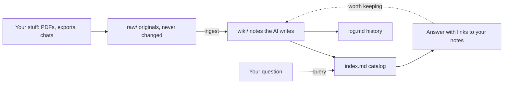

# Second Brain Template

**A notes vault that an AI keeps organised for you.** Drop in your stuff (PDFs, old chats, your resume, app exports), and the AI turns it into linked notes. Later, ask questions like *"what did I decide about my car loan?"* and get answers that point back to your own notes.

Built on [Obsidian](https://obsidian.md) (free notes app) and [Claude Code](https://code.claude.com/docs/en/quickstart) (AI assistant). **No coding needed.** If you've never set anything like this up, it makes a great first project.

Built by **Hari** ([builtby-hari](https://github.com/builtby-hari)). Copy it, make it yours.

> Everything in `wiki/` is **made-up sample content** about a fictional person, "Alex Rivera", so you can see what a filled-in vault looks like. You'll replace it with your own.

---

## Start here

| If you want to... | Go to |
|---|---|
| Set it up from zero (never used a terminal) | **[Getting Started](docs/GETTING-STARTED.md)**, about 30 minutes |
| Know where to download your data from apps (ChatGPT, LinkedIn, Google, Spotify, notes apps, bank...) | **[Where to Get Your Data](docs/EXPORTS.md)** |
| Copy-paste prompts for every task | **[Prompts to Copy](docs/PROMPTS.md)** |
| Fix a problem or get a question answered | **[FAQ and Troubleshooting](docs/FAQ.md)** |
| Just steal ideas for your own vault | [What's inside](#whats-inside) and [Ideas worth copying](#ideas-worth-copying) below |

## Quick start (if you've done this before)

1. Click **Use this template** (choose **Private**), or **Code > Download ZIP**.
2. Open the folder in Obsidian (**Open folder as vault**). Enable the `brain-colors` and `brain-glow` CSS snippets under **Settings > Appearance**.
3. Install Claude Code, then `cd` into the folder and run `claude`.
4. Say: *"Replace the Alex Rivera sample content with a blank profile for me."*
5. Drop a file into `raw/` and say: *"Ingest raw/<file> following CLAUDE.md."*

## What it costs

| Piece | Cost |
|---|---|
| This template, Obsidian, Python, GitHub | Free |
| Claude Code | Needs a paid Claude plan or API credits ([pricing](https://claude.com/pricing)) |
| Optional: [Obsidian Sync](https://obsidian.md/sync) to see notes on your phone | Paid, or use iCloud / Drive for free |

---

## How it works



1. **Ingest:** a source goes into `raw/`. Claude writes a summary note, updates every person, place, project and idea it mentions, rebuilds the index and logs what changed.
2. **Query:** Claude reads `index.md`, finds the right notes and answers with `[[links]]`. Anything it can't find is marked **UNKNOWN** instead of guessed.
3. **Lint:** now and then Claude checks for contradictions, stale facts, orphan notes and broken links, and fixes what's safe.
4. **Brain Questions:** Claude keeps a list of things it wants to know about you. Answer a few in `wiki/Brain Questions.md`, run `/answered`, and it fills in the vault.

## What's inside

| Piece | What it does |
|---|---|
| `CLAUDE.md` | **The rulebook.** Folder layout, naming rules, note format and the ingest / query / lint workflows. Claude reads it every session |
| `raw/` | Your original files. Read-only, so you can always check a note against its source. `raw/private/` is never backed up to GitHub |
| `wiki/` | The notes, in numbered folders: Inbox, Timeline, Me, Knowledge, Projects, Journals & Trackers, Library, Chats, Archive, plus `entities/` and `concepts/` |
| `index.md` + `log.md` | A one-line summary of every note, and a history of every change |
| `wiki/Home.md` | The front door: links to everything important |
| `wiki/Brain Questions.md` + `.claude/commands/answered.md` | The question-and-answer loop that fills a new vault fast |
| `wiki/Dashboard.base` | Obsidian Bases tables: recently changed, projects, people, trackers, thin notes |
| `wiki/Diagrams.md`, `wiki/Brain Map.canvas` | Mermaid diagrams and a canvas map of the whole vault |
| `scripts/` | Three small Python scripts (no installs needed) that rebuild the index, folder indexes and Brain Map |
| `.obsidian/` | The look: dark glowing graph, blue folder colours, graph colour groups |
| `docs/` | The beginner guides linked above |

Rebuild the generated files any time (or just ask Claude to):

```
python3 scripts/make_index.py
python3 scripts/make_folder_indexes.py
python3 scripts/make_canvases.py
```

## Ideas worth copying

Even if you don't use the whole template, these ideas work in any notes setup:

- **Keep originals separate from notes.** `raw/` never changes; `wiki/` is the AI's interpretation. When a note looks wrong, you can check the source.
- **Give the AI a rulebook file.** One `CLAUDE.md` with your folder rules and workflows makes every session behave the same.
- **One-line summary on every note.** It's what makes `index.md` useful, and it lets the AI find things without reading every file.
- **Say UNKNOWN, don't guess.** When sources disagree, the note records both.
- **Let the AI ask *you* questions.** A running question list fills gaps much faster than writing a profile from scratch.
- **Plan before big imports.** Ask for a plan, check it, then let it run in batches.
- **Standing facts.** A short list in `CLAUDE.md` of things the AI must never mix up (two people with the same name, a rule you've decided on).
- **Log everything.** `log.md` means you can always see what changed and when.

## Privacy

- **Make your copy Private.** A second brain holds messages, contacts, money and health info. A public GitHub repo is visible to everyone.
- **Big and sensitive exports go in `raw/private/`**, which `.gitignore` keeps off GitHub, along with `.zip` files.
- **What Claude reads is sent to Anthropic** to answer you, like any Claude chat. Nothing is published unless you push it somewhere public.

## Make it yours

The folders are a starting point. Rename or add folders to fit your life, then update the table in `CLAUDE.md`, `BLURBS` in `scripts/make_folder_indexes.py` and `ZONES` in `scripts/make_canvases.py` so the AI and the scripts agree. Or ask Claude to do it ([prompt here](docs/PROMPTS.md#making-it-yours)).

Using a different AI tool? Copy `CLAUDE.md` to `AGENTS.md`; most coding assistants read one or the other.

## License

MIT. See [LICENSE](LICENSE). Built by Hari (builtby-hari).
