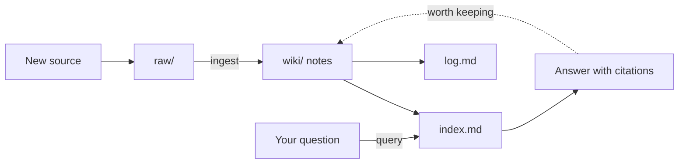

# Second Brain Template

A ready-to-copy **second brain**: an [Obsidian](https://obsidian.md) vault that an AI assistant (Claude Code) reads, writes and keeps tidy for you. You drop in sources (PDFs, chats, links, spreadsheets), the AI turns them into linked notes, and later you ask questions and get answers that cite your own notes.

Built by **Hari** ([builtby-hari](https://github.com/builtby-hari)). Copy it, make it yours.

> Everything in `wiki/` is **invented sample content** about a fictional person, "Alex Rivera". Delete it and replace it with your own life.

## What you get

| Piece | What it does |
|---|---|
| `CLAUDE.md` | The rulebook: folder layout, naming, frontmatter and the INGEST / QUERY / LINT workflows the AI follows |
| `raw/` | Your original sources. Never edited, only read |
| `wiki/` | Notes the AI writes and maintains, sorted into numbered folders |
| `index.md` + `log.md` | A catalog of every note with a one-line summary, and an append-only history of changes |
| `scripts/` | Small Python scripts that rebuild the index, the folder indexes and the Brain Map canvas |
| `.obsidian/` | The look: dark glowing graph, blue folder colors, graph color groups |
| `wiki/Diagrams.md`, `wiki/Brain Map.canvas` | Mermaid diagrams and a canvas that show how everything connects |
| `wiki/Dashboard.base` | An Obsidian Bases dashboard: recently changed notes, projects, people, thin notes |

## How it works



1. **Ingest:** a source goes into `raw/`, the AI writes a summary note, updates every person, organization and idea page it touches, rebuilds the index and logs it.
2. **Query:** the AI reads `index.md`, searches the knowledge graph, reads the cited notes and answers with `[[links]]`. Anything it can't find is marked UNKNOWN instead of guessed.
3. **Lint:** now and then the AI checks for contradictions, stale claims, orphan notes and broken links.

## Set it up (about 20 minutes)

1. **Install Obsidian** (free) from [obsidian.md](https://obsidian.md).
2. **Get the template.** Click **Use this template** on GitHub, or run:
   ```
   git clone https://github.com/builtby-hariAI/second-brain-template.git "My Second Brain"
   ```
3. **Open it in Obsidian:** *Open folder as vault* and pick the folder.
4. **Turn on the look:** *Settings > Appearance > CSS snippets* and enable `brain-colors` and `brain-glow`.
5. **Install Claude Code** ([docs](https://docs.claude.com/en/docs/claude-code)) and start it inside the vault folder: `cd "My Second Brain" && claude`.
6. **Optional, for search:** install graphify and run `/graphify` once so the AI can query the vault as a graph.
7. **Make it yours:**
   - Edit the "Standing facts" section at the bottom of `CLAUDE.md` with your own rules.
   - Delete the sample notes, then add your own profile.
   - Update `ZONES` in `scripts/make_canvases.py` to point at your notes, then run `python3 scripts/make_canvases.py`.
8. **First ingest.** Drop a PDF into `raw/`, then tell Claude: *"Ingest raw/<file> following CLAUDE.md."*

Rebuild the catalog any time:

```
python3 scripts/make_index.py
python3 scripts/make_folder_indexes.py
python3 scripts/make_canvases.py
```

## Ground rules that make it work

- **`raw/` is read-only.** Sources stay untouched so you can always check a note against its origin.
- **Every note name is unique.** Obsidian links by name, so the AI checks before creating a page.
- **Every note starts the same way:** frontmatter with a one-line `summary`, an H1, a nav line, then a short summary. That's what lets `index.md` stay useful.
- **Say UNKNOWN, don't guess.** When two sources disagree, the note records both.
- **Keep private data out of anything you share.** Contact details, resumes, account numbers and health data belong in your private copy only.

## Make it yours

The `02 Me` to `07 Chats` folders are a starting point. Rename or add folders to fit your life, then update the table in `CLAUDE.md` and the `BLURBS` in `scripts/make_folder_indexes.py` so the AI and the scripts agree.

## License

MIT. See [LICENSE](LICENSE). Built by Hari (builtby-hari).
