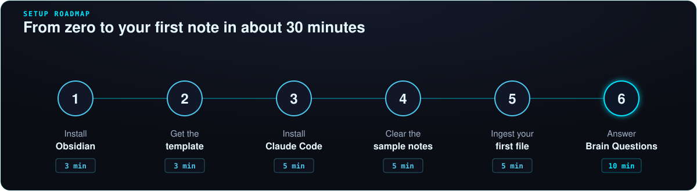
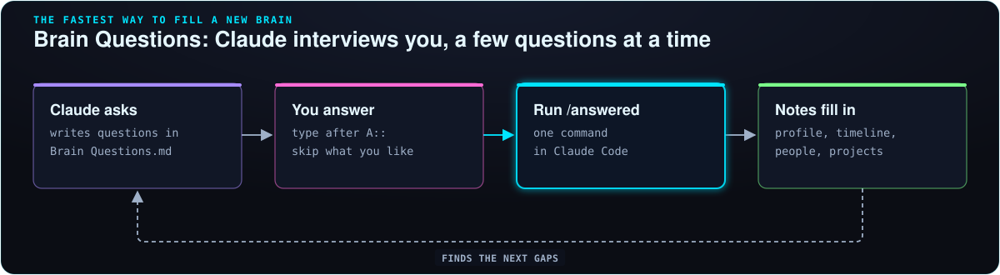

# Getting Started (from zero)

This guide assumes you have **never** used a terminal, GitHub or Obsidian. Follow it top to bottom. It takes about **30 minutes** the first time.

Back to the [README](../README.md) · Next: [Where to get your data](EXPORTS.md)

<p align="center"></p>

---

## What you are building, in plain words

- **Obsidian** is a free notes app. Your notes are plain text files in a normal folder on your computer, so nothing is locked into an app.
- **Claude Code** is an AI assistant that can read and write the files in that folder. You talk to it in plain English.
- **This template** is a folder already set up with the right structure plus a rulebook (`CLAUDE.md`) that tells Claude how to keep your notes tidy.

You put things in (PDFs, exported chats, your resume, a link), Claude turns them into linked notes, and later you ask questions like *"what did I decide about my car loan?"* and get an answer that points to your own notes.

## What you need

| Thing | Cost | Why |
|---|---|---|
| A Mac, Windows or Linux computer | — | Claude Code runs on your computer |
| [Obsidian](https://obsidian.md) | Free | To read and browse your notes |
| A [Claude](https://claude.ai) account on a paid plan (Pro or higher), or API credits | Paid | Claude Code needs it. Check current prices on [claude.com/pricing](https://claude.com/pricing) |
| [Python 3](https://www.python.org/downloads/) | Free | Runs the small helper scripts. Macs usually have it already |
| A [GitHub](https://github.com) account | Free, optional | Only if you want an online backup |

> **You can try the notes side for free.** Obsidian and the template work without Claude. You just won't have the AI filing things for you.

---

## Step 1. Learn the one terminal trick you need (2 min)

The **terminal** is a window where you type commands instead of clicking.

- **Mac:** press `Cmd + Space`, type `Terminal`, press Enter.
- **Windows:** press the Windows key, type `PowerShell`, press Enter.

You only need three things:
1. **Paste** a command (`Cmd+V` on Mac, right-click or `Ctrl+V` on Windows) and press **Enter**.
2. `cd "path/to/folder"` means "go into this folder". Tip: type `cd ` (with a space) and then **drag the folder from Finder/Explorer into the window**; it fills in the path for you.
3. If something goes wrong, copy the error text and paste it into Claude. It will tell you what to do.

## Step 2. Install Obsidian (3 min)

1. Go to [obsidian.md](https://obsidian.md) and click **Download**.
2. Install it like any app. Don't create a vault yet.

## Step 3. Get the template (3 min)

Pick **one** of these:

**A. Easiest, no GitHub account:** on the [repo page](https://github.com/builtby-hariAI/Second-Brain-Template), click the green **Code** button, then **Download ZIP**. Unzip it, rename the folder to `My Second Brain`, and move it somewhere you'll keep it, like `Documents`.

**B. With an online backup:** click **Use this template > Create a new repository**. **Set it to Private.** Your second brain will hold personal things, and a public repo is visible to the whole internet. Then download your copy with the green **Code** button (ZIP), or with git:

```
git clone https://github.com/YOUR-USERNAME/YOUR-REPO-NAME.git "My Second Brain"
```

## Step 4. Open it in Obsidian (2 min)

1. Open Obsidian and choose **Open folder as vault**.
2. Pick your `My Second Brain` folder.
3. If it asks whether to trust the vault, choose **Trust**. (The template ships no plugins, only colours and settings.)
4. Turn on the look: **Settings** (gear, bottom left) **> Appearance > CSS snippets**, and switch on `brain-colors` and `brain-glow`.
5. Open `wiki/Home.md`. That is your front door. Press `Cmd/Ctrl + G` to see the graph.

## Step 5. Install Claude Code (5 min)

Copy the line for your computer into the terminal and press Enter. (These come from the [official quickstart](https://code.claude.com/docs/en/quickstart); check there if one fails.)

**Mac or Linux:**
```
curl -fsSL https://claude.ai/install.sh | bash
```

**Windows (PowerShell):**
```
irm https://claude.ai/install.ps1 | iex
```

Close the terminal and open a new one, then check it worked:
```
claude --version
```

## Step 6. Start Claude inside your vault (2 min)

```
cd "path/to/My Second Brain"
claude
```

The first time, it opens a browser so you can log in with your Claude account. Then say hi:

> *Read CLAUDE.md and index.md, then explain in three sentences how this vault works.*

If it answers with the folders and the ingest / query / lint workflows, you're set up.

## Step 7. Check Python (1 min)

```
python3 --version
```

On Windows, try `python --version` if `python3` isn't found. If neither works, install Python from [python.org/downloads](https://www.python.org/downloads/) and **tick "Add Python to PATH"** during setup. Then, from the vault folder:

```
python3 scripts/make_index.py
```

You should see `index.md written: 11 notes`.

## Step 8. Clear out the sample person (5 min)

Everything in `wiki/` is about a made-up person, "Alex Rivera". Ask Claude to do the swap:

> *Replace the Alex Rivera sample content with a blank profile for me. My name is ___. Keep the folder structure, Home, Diagrams, Brain Questions, the Note Template and the folder index notes. Delete the other sample notes, fix any broken links, update ZONES in scripts/make_canvases.py, then rebuild the index, folder indexes and canvas.*

## Step 9. Your first real note (5 min)

1. Grab one file you care about: your resume, a class syllabus, a PDF statement.
2. Drop it into the matching `raw/` subfolder (create it if needed, for example `raw/02 Me/`).
3. Tell Claude:

> *Ingest raw/02 Me/resume.pdf following CLAUDE.md.*

Watch the new note appear in Obsidian. That's the whole loop.

## Step 10. Let Claude interview you (10 min, any time)

Open `wiki/Brain Questions.md`, answer whatever you like, skip the rest, then type `/answered` in Claude. It files your answers into the right notes and writes the next batch of questions. This is the fastest way to fill a brand-new brain.

<p align="center"></p>

## Step 11 (optional). Search your brain as a graph

[graphify](https://github.com/Graphify-Labs/graphify) builds a searchable map of your notes, so Claude can answer questions across hundreds of them. It needs Python 3.10 or newer.

```
pipx install graphifyy
graphify install
```

(No `pipx`? Use `pip install graphifyy`. The package name really has two y's.) Then inside Claude, run `/graphify` once, and `/graphify --update` after big changes.

## Step 12 (optional). Back it up

- **GitHub (private repo):** ask Claude *"commit my changes and push them"* at the end of a session.
- **No GitHub:** keep the folder inside iCloud Drive, OneDrive, Dropbox or Google Drive, or use [Obsidian Sync](https://obsidian.md/sync) (paid).

---

**Next:** fill your brain with data you already own. See [Where to get your data](EXPORTS.md), then grab some [prompts to copy](PROMPTS.md). Stuck? See the [FAQ](FAQ.md).
