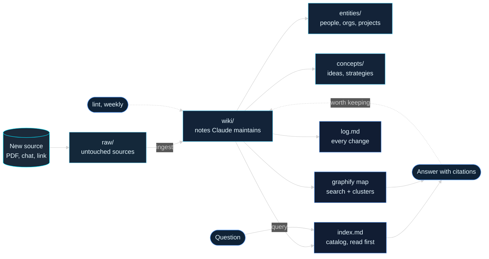
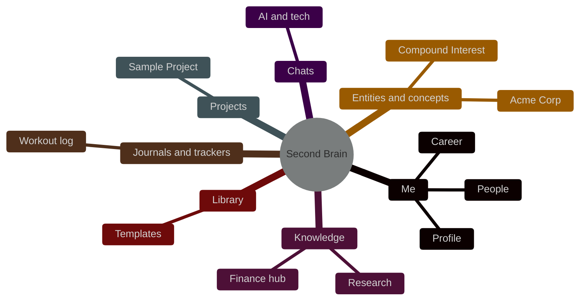
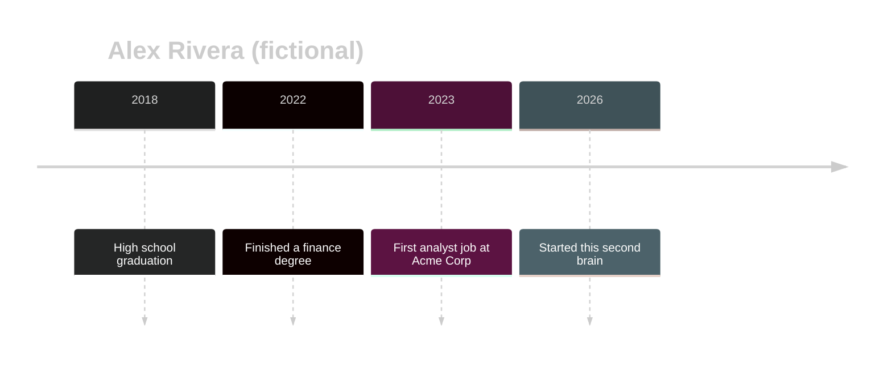

# Diagrams

Back to [[Home]] · Canvas: [[Brain Map.canvas|Brain Map]]

> [!summary] Summary
> Three diagrams. The first shows how a new source becomes notes and answers, the second maps the vault, the third is a sample timeline. Mermaid renders these natively in Obsidian.

## How this brain works

## The brain at a glance

## Sample life timeline

